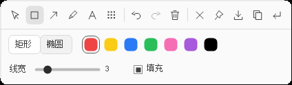
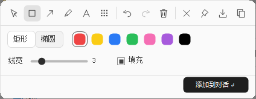

# dsh-FocusCapture

<p align="center">
  
</p>

<p align="center">
  <strong>为 DeepSeek Harness 打造的 Windows 截图、标注与置顶贴图插件</strong>
</p>

<p align="center">
  <a href="https://github.com/janehk416-alt/dsh-FocusCapture/releases/latest"></a>
  
  
  <a href="LICENSE"></a>
</p>

无需离开当前聊天，即可框选屏幕、添加标注、复制或保存截图，并将图片放入当前聊天的附件草稿。支持 **左 Ctrl + 右 Ctrl** 全局快捷键、紧凑编辑工具栏，以及跨应用置顶贴图。

**English:** A Windows screenshot and annotation plugin for DeepSeek Harness, with a dual-Ctrl shortcut, always-on-top pinned images, PNG export, and direct attachment to the current chat draft. See [Releases](https://github.com/janehk416-alt/dsh-FocusCapture/releases) for downloads.

> [!NOTE]
> 本项目仅支持 **Windows 10/11 + DeepSeek Harness（DSH）**。插件不会自动发送聊天消息，也不会修改输入框中已有的文字。

## 功能亮点

- **两种截图入口**：点击聊天输入框的截图图标，或同时按住左 Ctrl 与右 Ctrl。
- **完整标注工具**：选区移动与缩放、矩形、椭圆、箭头、自由涂鸦、文字和马赛克。
- **可编辑样式**：七色调色板、线宽、字号、形状填充，以及已选标注的样式修改。
- **便捷导出**：复制到剪贴板、另存为 PNG，或添加到当前聊天附件草稿。
- **置顶贴图**：生成跨应用置顶图片，支持拖动、滚轮缩放、复制、保存与关闭。
- **本地处理**：截图和标注在本机完成，不联网、无遥测，不记录其他按键。
- **会话防误投**：开始截图时锁定目标聊天，切换页面不会把截图投递到其他聊天。

## 界面预览

<p align="center">
  
</p>

<p align="center">
  
</p>

工具栏保持紧凑：没有底部按钮栏、说明输入框或序号标注工具。空间不足时，工具栏会自动调整到选区上方或屏幕内。

## 环境要求

| 项目 | 要求 |
| --- | --- |
| 操作系统 | Windows 10 或 Windows 11 |
| DSH | `>=0.2.2-rc.1 <0.3.0` |
| 运行依赖 | 使用 DSH 自带的 Node.js 与 Python，无需单独安装 |
| 安装准备 | 无需 `npm install`；安装包已包含 `native/DualCtrlSnip.exe` |

## 安装

### 方法一：从 GitHub Release 安装（推荐）

1. 打开 [**Latest Release**](https://github.com/janehk416-alt/dsh-FocusCapture/releases/latest)。
2. 下载 **`dsh-FocusCapture-1.3.0-install.zip`**；日常安装不需要下载 GitHub 自动生成的 Source code。
3. 解压 ZIP，得到 `dsh-FocusCapture` 文件夹。该文件夹内应直接包含 `package.json`、`host-v1.1.js`、`icon.png` 和 `native` 目录。
4. 在 DSH 插件管理的安装向导中，将 Bundle 安装来源设为该**解压目录的绝对路径**，不要选择 ZIP 文件本身。需要显式来源类型时，使用以下格式：

   ```text
   link:D:\Plugins\dsh-FocusCapture
   ```

5. 安装后启用 **dsh-FocusCapture**。如果聊天页面已经打开，刷新页面以加载最新 Client 和图标。
6. 可通过 Release 中的 `SHA256SUMS.txt` 核对安装包完整性。

更新时，在插件管理中对同一 Bundle 执行更新即可；内部标识保持为 `@local/dsh-focuscapture`，便于保留已有启用状态。

### 方法二：从源码安装

```bash
git clone https://github.com/janehk416-alt/dsh-FocusCapture.git
```

然后在 DSH 插件管理中安装克隆下来的仓库根目录。仓库已包含生成的 `client.js` 和 Windows 原生 EXE，因此直接安装不需要先执行构建。

## 快速使用

1. 打开需要接收截图的 DSH 聊天。
2. 点击输入框中的截图图标，或同时按住 **左 Ctrl + 右 Ctrl**。
3. 拖动框选屏幕区域，按需添加标注。
4. 选择复制、保存、置顶，或点击 **“添加到对话”** 回车图标。
5. 截图进入附件草稿后，可以继续在输入框中编辑文字，再由你手动发送。

两个 Ctrl 都松开后，快捷键才允许再次触发。没有可接收的聊天、页面连接失效或组件尚未就绪时，插件会拒绝开始截图，而不是把图片投到未知位置。

## 工具与快捷键

| 操作 | 功能 |
| --- | --- |
| 选择 / 移动 / 缩放 | 移动标注、四角调整大小；空白处移动选区，选区外重新框选 |
| 矩形 / 椭圆 | 拖动绘制；椭圆按住 Shift 可画正圆 |
| 箭头 | 从起点拖到终点，支持任意方向 |
| 涂鸦 | 按住左键自由绘制 |
| 文字 | 保留截图与标注背景，支持中文输入法、光标、选择和删除 |
| 马赛克 | 拖动涂抹，可在设置中调整强度 |
| 图钉 | 创建独立置顶贴图；拖动移动、滚轮缩放，右键管理 |
| Ctrl+Z | 撤销 |
| Ctrl+Y / Ctrl+Shift+Z | 重做 |
| Delete | 删除所选标注；未选中时清空全部，可撤销 |
| Ctrl+S | 另存为 PNG，保留编辑器 |
| Ctrl+C | 复制图片，保留编辑器 |
| Enter | 非文字编辑状态下，添加到当前聊天附件草稿 |
| Enter（文字编辑中） | 换行 |
| Ctrl+Enter（文字编辑中） | 完成文字编辑 |
| Esc / 右键 | 取消当前编辑或退出；贴图窗口中 Esc 关闭当前贴图 |

> 敏感信息建议使用实心黑色矩形完全覆盖；马赛克不等同于不可逆的加密处理。

## 隐私与安全边界

- 不联网、无遥测。只有主动复制才修改剪贴板，主动保存并确认文件名后才写出图片。
- 双 Ctrl 检测只读取左右 Ctrl，不安装键盘钩子、不记录其他按键。
- 图片与贴图暂存在进程内存中；工具栏、颜色板、光标和编辑控件不会进入导出图。
- 使用 DSH 的认证接口和官方附件草稿入口，不插入假路径，不改写已有聊天文本。
- 截图目标在开始时即被锁定；添加附件后**不自动发送消息**。
- 无开机自启、计划任务、注册表修改或额外监听端口。

## 已知限制

- UAC 安全桌面、系统强制遮挡、独占全屏及其他强制最上层窗口不保证覆盖。
- 多屏混合 DPI 和具体输入法组合仍需在实际设备上验收。
- 网页刷新或关闭会丢失该页面尚未投递的截图；页面连接失效超过 3 分钟后不开始截图。
- 2 分钟无交互会取消编辑；停用或退出 DSH 会关闭贴图、编辑器和键检测组件。
- 虚拟桌面上限 6000 万像素；选区上限 2500 万像素、20 MiB；最多暂存 3 张截图，5 分钟释放。
- 每张最多 200 个标注，每笔涂鸦最多 4096 点，每次文字最多 4096 字，历史最多 30 步。

## 源码构建与验证

### Web Client

```bash
node build-client.mjs
```

该命令从 `client.source.js` 和 `delivery.js` 生成 `client.js`，无新增前端依赖。`client.js` 应提交到仓库，便于用户直接安装。

### 自动测试

```bash
npm test
./native/DualCtrlSnip.exe --self-test
```

- Node 测试：20 项，覆盖目标聊天锁定、附件草稿、过期释放、快捷键事件、UI 契约等。
- 原生自检：覆盖绘图、历史、裁剪、工具图标、截图背景文字输入、置顶样式与局部绘制等。
- `tests/ui-native-smoke.py` 提供真实编辑器交互测试；默认不修改剪贴板、不保存截图、不发送聊天。

涉及真实系统 Ctrl 事件的测试，运行前建议先停用当前插件，避免触发真实截图。局部绘制基准不等同于界面实际 FPS。

## 项目结构

```text
dsh-FocusCapture/
├── package.json              # Bundle 清单、版本、图标与兼容范围
├── host-v1.1.js / index.js   # Node Host 入口与会话绑定
├── client.source.js          # Web Client 源码
├── client.js                 # 已生成、可直接安装的 Client
├── core.js / delivery.js     # 状态管理与附件草稿投递
├── native/                   # C# 源码、快捷键组件与运行 EXE
├── locale/                   # 中英文显示名称
├── tests/                    # Node 与原生交互测试
├── docs/images/              # README 界面预览
├── icon.png                  # 插件管理页图标
├── CHANGELOG.md              # 版本历史
└── LICENSE                   # 代码 MIT 许可证
```

## 版本与问题反馈

- 下载与发布说明：[GitHub Releases](https://github.com/janehk416-alt/dsh-FocusCapture/releases)
- 版本历史：[CHANGELOG.md](CHANGELOG.md)
- 问题反馈：[GitHub Issues](https://github.com/janehk416-alt/dsh-FocusCapture/issues)

反馈问题时，请附上 Windows 版本、DSH 版本、复现步骤和预期结果。截图前请遮盖聊天内容、账号、路径及其他敏感信息。

## 许可证与图标说明

代码采用 [MIT License](LICENSE)。

`icon.png` 来自用户提供的图片；第三方图片不因其包含在本仓库中而自动适用 MIT 许可证。公开展示或再分发该图标时，请确保具备相应权利或许可。
